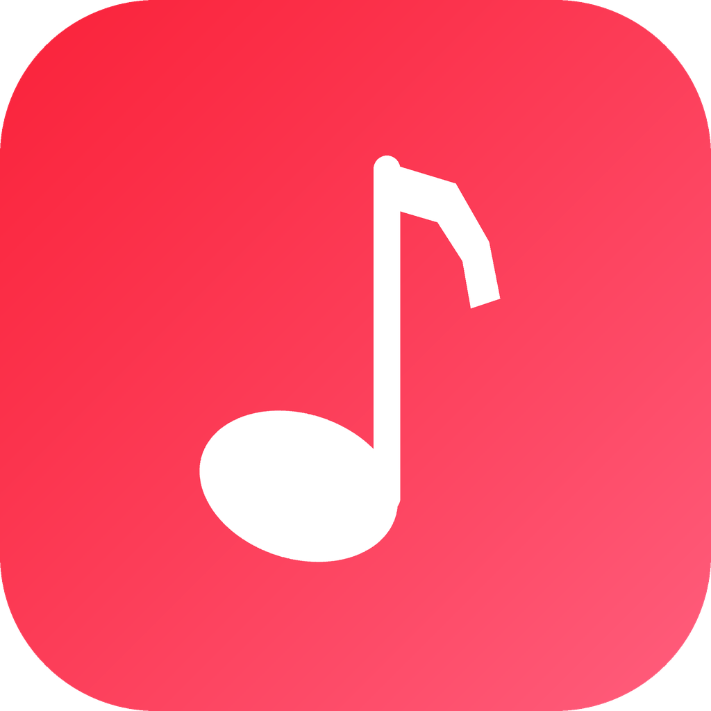

<div style="display: flex; gap: 1rem;">
  
  <div>
      <h1>CrystaList</h1>
      <h3>An Apple Music inspired YouTube Music client for Android, iOS and desktop</h3>
  </div>
</div>

<br>

CrystaList is a free, open-source YouTube Music player with an Apple Music inspired
interface: a white or true-black canvas, an `#FA243C` accent, SF-style typography and
calm, iOS-like motion.

> [!WARNING]
> Using CrystaList to access YouTube Music may violate YouTube's Terms of Service.
> You use it at your own risk. CrystaList does not host, upload or distribute any music;
> it streams from YouTube Music exactly like the official website and does not bypass DRM.
> Premium-only quality still needs your own YouTube Music Premium subscription.
> YouTube Music is region-restricted; a VPN or proxy in a supported region may be required.

## Features

- YouTube Music playback with or without signing in
- Android 7+, iOS 15+, Windows 10+, macOS 15+ and Linux
- Apple Music inspired design: red accent, iOS surfaces, SF-style type
- No ads, background playback and offline downloads
- Synced lyrics with translation and romanization
- Listen Together for shared playback
- Casting to Google Cast, F-Cast, SONOS and DLNA
- Backup and playlist import from 30+ clients
- Discord Rich Presence, Last.fm and ListenBrainz scrobbling
- Translations in over 15 languages

## Download

Set up builds for each platform from
[GitHub Releases](https://github.com/CrystaListGroup/CrystaList/releases).
Platform guides live in [`docs/install`](docs/install/README.md).

## Build from source

```bash
git clone --recursive https://github.com/CrystaListGroup/CrystaList.git
cd CrystaList
# Android (needs JDK 25 and Android SDK 37.1)
./gradlew :androidApp:assembleDebug
# Desktop (Linux/macOS/Windows)
./gradlew :desktopApp:run
```

See [`REBRAND.md`](REBRAND.md) for every place the fork still points upstream
(Discord app id, sync server, update channel) before you publish your own build.

## Thanks

CrystaList builds on these projects: InnerTubeX (streaming engine), Lyprio (lyrics),
metroserver (Listen Together backend), MusicRecognizer (Shazam recognition) and Blacksmith
(CI runners). Original CrystaList fork credits and contributor profiles remain in the app's
About screen.

## Licensing

GPL-3.0. CrystaList is a fork of
[Metrolist](https://github.com/MetrolistGroup/Metrolist); original code remains under the
authors' copyright and is credited in the app's About screen. The "Metrolist" name and
logo are not covered by the licence and are not used here.

This project is not affiliated with, funded, authorized or endorsed by YouTube, Google LLC,
Apple Inc., MetroList MLS, or their affiliates and subsidiaries. All trademarks belong to
their respective owners.
